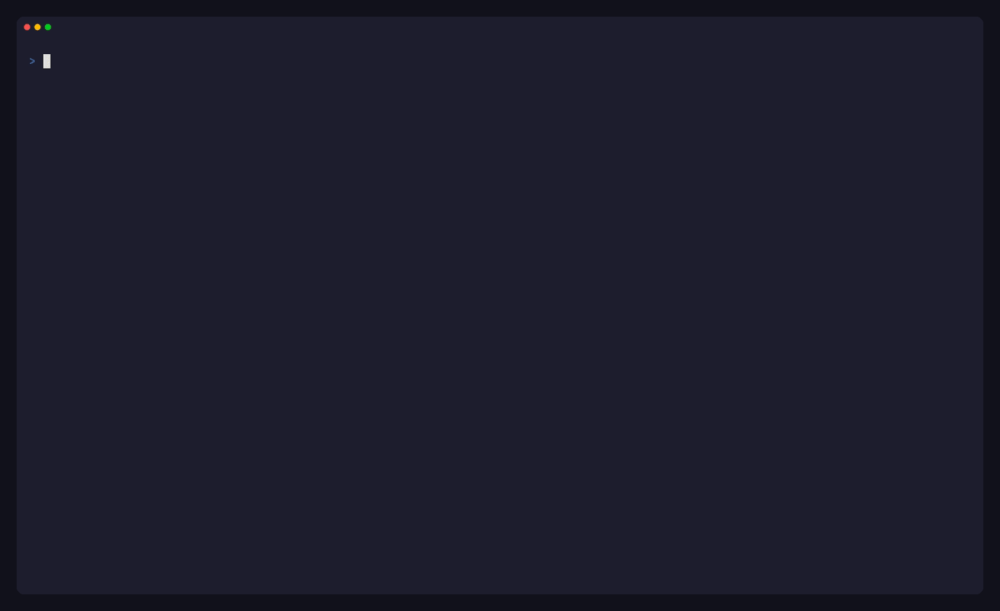
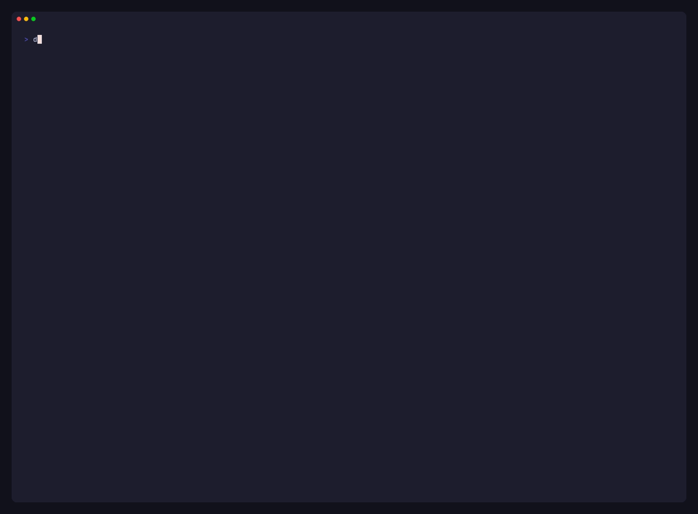

<div align="center">

<picture>
  <source media="(prefers-color-scheme: dark)" srcset="../assets/banner-dark.svg">
  
</picture>

**Un nettoyeur de disque en arrière-plan pour les machines de développement, qui sait ce qu’il supprime.**

[](https://github.com/eukalpia/diskgc/actions/workflows/ci.yml)
[](https://github.com/eukalpia/diskgc/releases)
[](../../LICENSE)


[English](../../README.md) · [Русский](README.ru.md) · [O‘zbekcha](README.uz.md) · [简体中文](README.zh-CN.md) · [Español](README.es.md) · [हिन्दी](README.hi.md) · [العربية](README.ar.md) · **Français** · [Português](README.pt-BR.md) · [日本語](README.ja.md)



</div>

## Pourquoi

Les disques des développeurs se remplissent de choses que personne n’a demandé à garder : des répertoires Cargo `target/` qui grossissent de 100 Go en deux jours, des `node_modules` de branches abandonnées en juillet, des caches de build Go regénérés à chaque exécution de tests, des conteneurs oubliés par un test interrompu, des répertoires temporaires d’agents de programmation IA. macOS range tout cela sous « System Data » sans proposer d’aide ; `du` indique *où* se trouve l’espace, mais pas *ce qui peut être supprimé sans risque*.

diskgc tourne comme un petit démon, surveille l’espace libre et sa tendance, et ne supprime que ce qu’un outil peut régénérer, avec une raison écrite pour chaque action, un plan lisible avant toute opération et un historique de ce qui a été libéré.

## Points forts

- **Il explique ses décisions.** Chaque action s’accompagne d’une raison : *« le répertoire `target/` fait 105 Go (> plafond de 40 Go) : tout ce qui a plus d’un jour »*, *« projet inactif depuis 30 jours ; restauré par install »*.
- **Il connaît les projets, pas seulement les dossiers.** `target/` est repéré par son contenu, les répertoires de build uniquement à côté de leur marqueur de projet, et l’activité est évaluée sur l’ensemble du projet (un git worktree compte comme un projet à part entière).
- **Il agit avant que le disque ne soit plein.** Une prévision sur les six dernières heures anticipe le nettoyage ; les seuils se durcissent de *normal* à *bas*, puis à *critique*.
- **Il ne touche jamais à l’essentiel.** Les sources, `.git`, les bases de données et l’historique des discussions ne sont jamais candidats ; les globs exclus ne sont jamais touchés ; les journaux sont compressés sur place, pas supprimés.
- **Il trouve la cause.** `diskgc stats` montre la croissance par jour et par catégorie, ainsi que les chemins qui reviennent sans cesse : les endroits à corriger plutôt qu’à nettoyer.
- **Tableau de bord terminal et JSON.** Une TUI à six écrans, et `--json` sur chaque commande pour les scripts.

## Démarrage rapide

```sh
cargo install --locked --git https://github.com/eukalpia/diskgc diskgc
diskgc config --edit      # renseignez [scan] roots avec l’emplacement de vos projets
diskgc plan               # ce qu’un nettoyage supprimerait, et pourquoi — rien n’est touché
diskgc install            # lance le démon à la connexion (launchd / systemd --user / Planificateur de tâches)
diskgc status
```

Les binaires précompilés pour macOS (Apple Silicon, Intel), Linux (x86_64) et Windows (x86_64) sont joints à chaque [release](https://github.com/eukalpia/diskgc/releases) : décompressez `diskgc` (et éventuellement `diskgc-ui`) dans un répertoire de votre `PATH`.

<div align="center">

</div>

## Ce qu’il nettoie

| Règle | Quoi | Quand |
|-------|------|-------|
| Targets Rust | répertoires `target/` (repérés par leur contenu, où qu’ils se trouvent) | artefacts non touchés depuis 7 jours ; au-delà de 20 Go, caches incrémentaux et gros binaires de test aussi ; au-delà de 40 Go, tout ce qui a plus d’un jour ; un budget de 40 Go pour l’ensemble des targets |
| node_modules | `node_modules` à côté d’un `package.json` | rien dans le projet n’a changé depuis 30 jours |
| Répertoires de build | `.dart_tool`, `build`, `_build`, `.next`, `.turbo`, `__pycache__`, `.gradle`, … à côté d’un marqueur de projet | la même règle des 30 jours |
| Répertoires temporaires | espace de travail temporaire de chaque session Claude Code, vos propres entrées dans le répertoire temporaire système, répertoires de travail obsolètes dans le `$TMPDIR` de chaque utilisateur (macOS) | inactifs depuis 3 jours / 7 jours / 24 h |
| Outils IA | anciennes versions de l’application Codex, installations de runtime abandonnées | toujours (conserve la version courante + 1) |
| Docker | testcontainers orphelins, conteneurs arrêtés, volumes et images pendants, cache de build | 2 h / 24 h / 7 j |
| Caches d’outils | caches Go, npm, uv, pnpm et sccache au-delà d’un plafond, restes des mises à jour de Chrome et VS Code, téléchargements Homebrew, DerivedData de Xcode, caches de simulateurs et de shaders Metal | plafonds par règle |
| Fichiers froids | journaux de session et historiques JSONL de Codex et Claude Code | **compressés** par le système de fichiers (APFS, NTFS), jamais supprimés |

## Comment il décide

Le démon se réveille toutes les 10 minutes et examine l’espace libre :

| Espace libre | Comportement |
|--------------|--------------|
| au-dessus de `comfortable_gb` (150) | hygiène programmée toutes les 6 heures |
| en dessous de `comfortable_gb` | nettoyage immédiat avec les fenêtres normales |
| en dessous de `low_gb` (100) | niveau *bas* : toutes les fenêtres d’ancienneté sont divisées par deux |
| en dessous de `critical_gb` (60) | niveau *critique* : fenêtres divisées par quatre, plafonds de taille divisés par deux |

Un ajustement par moindres carrés sur les six dernières heures d’instantanés prédit l’espace libre dans 24 heures ; si cette prévision franchit un seuil, le démon escalade par anticipation. Chaque exécution est enregistrée, de sorte que `diskgc stats` montre la croissance par jour et par catégorie, ainsi que les récidivistes.

## Sécurité

diskgc supprime des fichiers, c’est son rôle, et il est donc conçu pour être prévisible :

- Il ne propose que ce qu’un outil peut régénérer (sorties de build, répertoires de dépendances, caches, fichiers temporaires) et donne la raison de chaque action ; `plan` et `clean -n` affichent exactement cette liste sans rien toucher.
- Les sources, `.git`, les bases de données et l’historique des discussions ne sont jamais candidats ; tout ce qui correspond à `[scan] exclude` n’est jamais touché ; l’exécuteur refuse tout chemin situé hors de `[safety] allowed_prefixes` (par défaut, votre répertoire personnel et les dossiers système des fichiers temporaires et des caches).
- `[safety] delete_mode = "trash"` déplace les éléments vers la corbeille au lieu de les supprimer définitivement (macOS et Linux ; si la corbeille se trouve sur un autre volume, l’outil revient à la suppression).
- Chaque exécution est journalisée (`diskgc history`) avec ce qui était prévu et ce qui a réellement été libéré.

Il s’exécute toujours sans surveillance, avec vos permissions. Lisez donc le premier `plan` sur votre machine avant d’installer le démon.

## Tableau de bord terminal

`diskgc ui` ouvre un tableau de bord construit avec [Cinder](https://github.com/eukalpia/cinder) qui communique avec le démon via son [protocole IPC](../PROTOCOL.md) :

| Écran | |
|-------|---|
| **Overview** | espace libre, niveau, prévision, répartition de l’espace |
| **Plan** | chaque action proposée avec sa raison : décochez ce qui doit rester, exécutez le reste ou faites une simulation |
| **Report** | les plus gros contributeurs par catégorie |
| **History** | exécutions, croissance par jour, récidivistes |
| **Memory** | RAM par programme, processus d’aide orphelins |
| **Log** | activité du démon en direct |

```
1-6 / tab   switch screens        r   refresh the current screen
p           build a plan          space / enter   toggle the highlighted action
x           execute selected      n   dry run             a   toggle all
k           terminate orphaned helper processes (Memory)   q   quit
```

Le tableau de bord est un exécutable natif distinct (`diskgc-ui`) ; `diskgc ui` le cherche à côté de `diskgc` ou dans `PATH`, et lance le démon si aucun n’est en cours d’exécution.

## Commandes

```
diskgc report            ce qui occupe le disque : catégories et plus gros contributeurs
diskgc plan              ce qu’un nettoyage ferait, avec les raisons — rien n’est touché
diskgc clean [-n]        nettoie maintenant (-n = plan uniquement)
diskgc status            état du démon, espace libre, prévision, dernière exécution
diskgc stats             croissance par jour, tendances par catégorie, récidivistes
diskgc history           exécutions récentes et ce qu’elles ont supprimé
diskgc mem               RAM par processus, processus d’aide orphelins (--kill-orphans)
diskgc install | uninstall
diskgc config [--edit|--show]
diskgc ui                tableau de bord terminal
```

Chaque commande accepte `--json`.

## Configuration

`~/.config/diskgc/config.toml` (Linux, macOS) ou `%APPDATA%\diskgc\config.toml` (Windows), créé avec les valeurs par défaut au premier lancement et relu par le démon à chaque cycle. Chaque clé est décrite dans [docs/CONFIG.md](../CONFIG.md). L’essentiel :

```toml
[scan]
roots = ["~/work", "~/src"]          # où se trouvent vos projets
exclude = ["~/work/keep-forever/**"] # globs qu’aucune règle ne peut toucher

[thresholds]
comfortable_gb = 150
low_gb = 100
critical_gb = 60

[safety]
delete_mode = "permanent"            # ou "trash"
```

## Plateformes

| Plateforme | Statut |
|------------|--------|
| macOS (APFS) | utilisé au quotidien ; la cible principale |
| Linux | testé en CI et dans des conteneurs ; démarrage automatique via `systemd --user` |
| Windows | compile et passe les tests en CI ; le démarrage automatique via le Planificateur de tâches est la partie la moins éprouvée, les retours sont bienvenus |

La compression transparente est disponible sur APFS et NTFS. Voir [docs/ARCHITECTURE.md](../ARCHITECTURE.md) pour la matrice des plateformes.

## Compilation depuis les sources

```sh
cargo build --release
cargo test
cd ui && dart pub get && dart compile exe bin/diskgc_ui.dart -o build/diskgc-ui
```

Les enregistrements présents dans ce README sont reproductibles à partir d’un répertoire personnel synthétique : voir [docs/demo](../demo).

## Contribuer

Les issues et les pull requests sont les bienvenues ; voir [CONTRIBUTING.md](../../CONTRIBUTING.md). Une nouvelle règle nécessite un test sur une arborescence synthétique qui montre à la fois ce qu’elle supprime et ce qu’elle doit laisser intact.

## Licence

[Apache-2.0](../../LICENSE).

---

*Ceci est une traduction. Le [README anglais](../../README.md) fait foi.*
